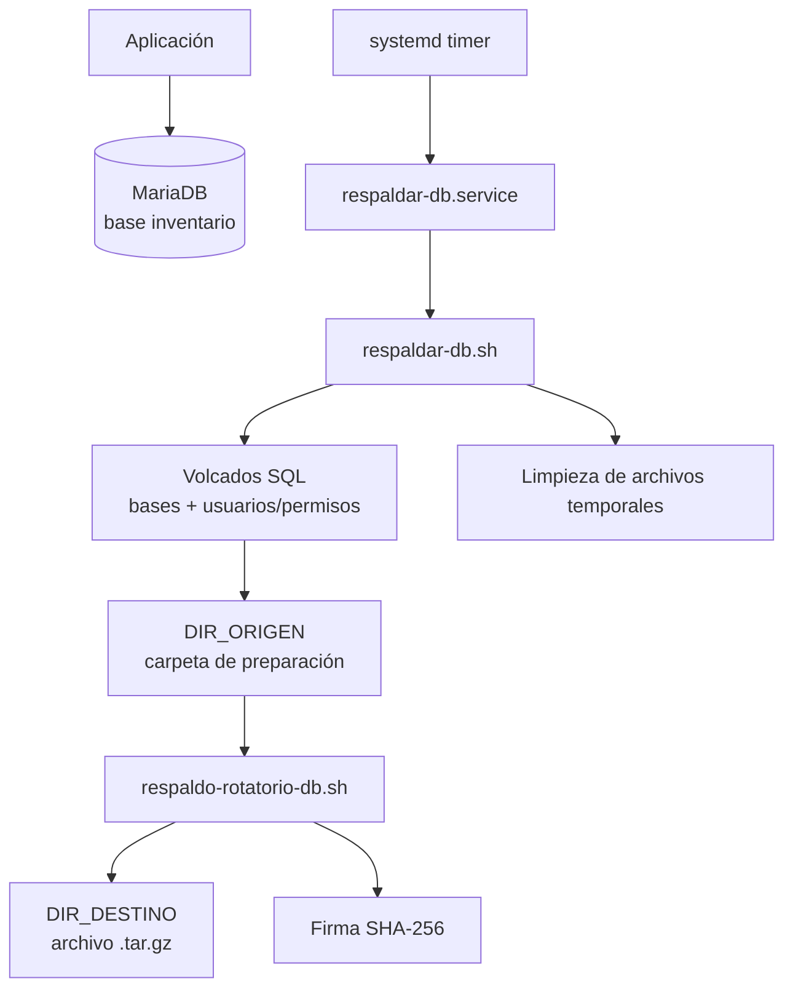

# servidor-db

[](https://github.com/marttin1987/servidor-db/actions/workflows/shellcheck.yml)

Proyecto de administración de MariaDB en Debian: usuarios de mínimo privilegio, volcados de bases y usuarios, integración con un motor de backup rotatorio, verificación de integridad y restauración de prueba.

## Problema que resuelve

Una base de datos necesita controles de acceso y una estrategia de recuperación verificable. Este proyecto documenta cómo limitar los permisos de la aplicación y automatizar respaldos, incluyendo una guía para probar la restauración sin modificar la base original.

## Arquitectura



El proyecto separa responsabilidades:

1. `scripts/respaldar-db.sh` genera y comprueba los volcados SQL.
2. `/usr/local/sbin/respaldo-rotatorio-db.sh` comprime los volcados, genera la firma SHA-256 y aplica la rotación.
3. `systemd/respaldar-db.service` y `systemd/respaldar-db.timer` permiten ejecutar el proceso de forma programada.

El script principal utiliza `flock` para impedir ejecuciones simultáneas y limpia la carpeta de preparación al finalizar.

## Qué incluye

| Área | Implementación | Documentación |
| --- | --- | --- |
| Instalación y usuarios | MariaDB, usuario de aplicación y permisos mínimos | [01 - Instalación y usuarios](docs/01-mariadb-instalacion-usuarios.md) |
| Backup de bases | `mariadb-dump` con transacción consistente, rutinas, triggers y eventos | [02 - Backups y restauración](docs/02-backups-restauracion.md) |
| Usuarios y permisos | Volcado adicional mediante `mariadb-dump --system=users` | [02 - Backups y restauración](docs/02-backups-restauracion.md) |
| Integridad y retención | Archivo `.tar.gz`, firma SHA-256 y política del motor rotatorio | [02 - Backups y restauración](docs/02-backups-restauracion.md) |
| Automatización | Unidad y timer de systemd | [02 - Backups y restauración](docs/02-backups-restauracion.md) |
| Calidad | ShellCheck mediante GitHub Actions | [Workflow](.github/workflows/shellcheck.yml) |

## Requisitos

- Debian con MariaDB y `mariadb-dump`.
- Bash y utilidades del sistema utilizadas por los scripts, incluyendo `flock`, `sha256sum` y `tar`.
- Acceso administrativo mediante `sudo`.
- Motor rotatorio instalado en `/usr/local/sbin/respaldo-rotatorio-db.sh`.
- Configuración disponible en `/etc/respaldos/db.conf`.

El proyecto se ha trabajado en Debian 13 sobre una VM de VirtualBox.

## Configuración

El archivo de configuración de ejecución es `/etc/respaldos/db.conf`. El repositorio incluye una plantilla en `config/db.conf.ejemplo`:

```bash
DIR_ORIGEN="/var/backups/mariadb/origen"
DIR_DESTINO="/var/backups/mariadb/copias"
LOG_FILE="/var/log/respaldo-mariadb.log"
DIAS_RETENCION=7
UMBRAL_DISCO_MAX=90
```

| Variable | Función |
| --- | --- |
| `DIR_ORIGEN` | Carpeta temporal de preparación de los volcados |
| `DIR_DESTINO` | Destino de los respaldos rotatorios |
| `LOG_FILE` | Registro del motor de backup |
| `DIAS_RETENCION` | Política de retención configurada |
| `UMBRAL_DISCO_MAX` | Umbral de ocupación de disco configurado |

El archivo de configuración real debe estar protegido y ser propiedad de `root`. No se deben subir credenciales ni datos de producción al repositorio.


## Instalación en Debian

Desde la raíz del repositorio, instalar ambos scripts:

```bash
sudo install -o root -g root -m 750 scripts/respaldo-rotatorio-db.sh /usr/local/sbin/respaldo-rotatorio-db.sh
sudo install -o root -g root -m 750 scripts/respaldar-db.sh /usr/local/sbin/respaldar-db.sh
```

Crear la configuración solo si todavía no existe:

```bash
sudo install -d -o root -g root -m 750 /etc/respaldos
sudo test -f /etc/respaldos/db.conf || sudo install -o root -g root -m 600 config/db.conf.ejemplo /etc/respaldos/db.conf
```

Si la configuración ya existe en Debian, conservarla y no sobrescribirla con la plantilla.

## Ejecución manual

El script principal espera ejecutarse con privilegios administrativos y requiere la configuración y el motor rotatorio:

```bash
sudo /usr/local/sbin/respaldar-db.sh
```

Por defecto respalda la base `inventario` y también genera un volcado de usuarios y permisos. Para indicar otras bases:

```bash
sudo env BASES="inventario otra_base" \
  /usr/local/sbin/respaldar-db.sh
```

La variable `MOTOR` permite indicar otra ruta para el motor rotatorio y `CONFIG` permite indicar otro archivo de configuración.

## Verificar un respaldo

Listar las copias del destino configurado:

```bash
sudo ls -lh /var/backups/mariadb/copias
```

Verificar la firma desde el directorio que contiene el archivo y su archivo de firma:

```bash
sudo sha256sum -c ARCHIVO.tar.gz.sha256
```

Inspeccionar el contenido sin extraerlo:

```bash
sudo tar -tzf ARCHIVO.tar.gz
```

Reemplazar los nombres de ejemplo por los archivos reales. La firma comprueba la integridad del archivo, pero no reemplaza una prueba de restauración.

## Restauración

La restauración debe probarse en una base de datos separada o en una instancia aislada. No eliminar ni sobrescribir la base original como parte de una prueba rutinaria.

1. Verificar la firma SHA-256.
2. Inspeccionar el contenido del archivo `.tar.gz`.
3. Extraer el volcado de la base a un directorio temporal protegido.
4. Crear una base de prueba vacía y restaurar allí el volcado correspondiente.
5. Verificar estructura y datos.
6. Probar la restauración de usuarios y permisos únicamente en una instancia aislada, ya que puede modificar cuentas y permisos.
7. Registrar los resultados y limpiar los recursos temporales.

Los comandos detallados y las precauciones están en [02 - Backups y restauración](docs/02-backups-restauracion.md).

## Pruebas y validación

El repositorio incluye un workflow de GitHub Actions para ejecutar ShellCheck. Las pruebas operativas del proyecto contemplan el resultado del volcado, el manejo de errores, la limpieza de temporales, la prevención de ejecuciones simultáneas, la integración con el motor rotatorio y la ejecución programada.

Las pruebas deben considerarse verificadas solo cuando exista evidencia reproducible de su ejecución. La documentación del procedimiento no implica que todas las pruebas se hayan vuelto a ejecutar en el estado actual del repositorio.

## Seguridad y límites

- Los volcados de usuarios pueden contener hashes de contraseñas y otros datos sensibles.
- Mantener protegidos los archivos de configuración, volcados y respaldos.
- Los respaldos guardados en el mismo disco no protegen frente a la pérdida física de ese disco.
- Una estrategia de producción debe incluir una copia externa y pruebas periódicas de recuperación.
- La restauración debe probarse en un entorno aislado antes de utilizarse en producción.

## Documentación

- [01 - MariaDB: instalación, revisión y usuarios](docs/01-mariadb-instalacion-usuarios.md)
- [02 - Backups de MariaDB y restauración](docs/02-backups-restauracion.md)

## Licencia

Licencia MIT. Ver [LICENSE](LICENSE).

## Rotación del log de backups

La configuración de Logrotate se versiona en
`config/logrotate-respaldo-mariadb` y rota diariamente el log
`/var/log/respaldo-mariadb.log`, conserva 14 rotaciones y comprime
los archivos antiguos.

Para instalarla en Debian:

```bash
sudo install -o root -g root -m 0644 \
  config/logrotate-respaldo-mariadb \
  /etc/logrotate.d/respaldo-mariadb
```

Validar la configuración sin ejecutar una rotación real:

```bash
sudo logrotate --debug /etc/logrotate.d/respaldo-mariadb
```

El temporizador del sistema `logrotate.timer` debe estar habilitado.
