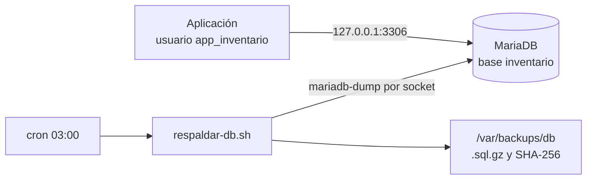

# servidor-db

[](https://github.com/marttin1987/servidor-db/actions/workflows/shellcheck.yml)

Servidor MariaDB en Debian con un usuario de mínimo privilegio, backups automáticos y restauración probada.

## Problema que resuelve

Una base de datos guarda lo más valioso de una aplicación y, si falla, no hay vuelta atrás sin una copia. Este proyecto muestra cómo instalarla de forma segura, darle a la aplicación solo los permisos que necesita y tener backups que se comprobaron restaurando, no solo creando.

## Arquitectura



## Qué incluye

| Área | Medidas | Documento |
| --- | --- | --- |
| Instalación | MariaDB solo en `127.0.0.1`, revisión de la configuración de fábrica | [01](docs/01-mariadb-instalacion-usuarios.md) |
| Usuarios | `root` solo por socket; `app_inventario` con permisos mínimos y contraseña generada, guardada con permisos `600` | [01](docs/01-mariadb-instalacion-usuarios.md) |
| Backups | Volcado consistente, escritura atómica, firma SHA-256, rotación a 7 días, `cron` diario | [02](docs/02-backups-restauracion.md) |
| Restauración | Prueba con comparación de tablas, desastre simulado y runbook | [02](docs/02-backups-restauracion.md) |

## Requisitos

- Debian con MariaDB (`sudo apt install mariadb-server`).
- Acceso `sudo`.

Probado en Debian 13 sobre una VM de VirtualBox.

## Uso

Instalar el script en una ruta de root y ejecutarlo:

```bash
sudo install -m 750 -o root -g root scripts/respaldar-db.sh /usr/local/sbin/respaldar-db.sh
sudo /usr/local/sbin/respaldar-db.sh
```

Para programarlo todos los días a las 03:00:

```bash
echo '0 3 * * * root /usr/local/sbin/respaldar-db.sh >> /var/log/db-backup.log 2>&1' | sudo tee /etc/cron.d/db-backup
sudo chmod 644 /etc/cron.d/db-backup
```

Los pasos para recuperar una base están en el runbook del [doc 02](docs/02-backups-restauracion.md).

## Configuración

Variables opcionales del script:

| Variable | Qué define | Valor por defecto |
| --- | --- | --- |
| `BASES` | Bases a respaldar, separadas por espacios | `inventario` |
| `DESTINO` | Carpeta de las copias | `/var/backups/db` |
| `RETENCION_DIAS` | Días que se conserva cada copia | `7` |

## Pruebas

- ShellCheck sin avisos en cada `push`, con GitHub Actions.
- El script se probó con un volcado simulado: caso correcto, caso con falla y rotación.
- Restauración en una base nueva con `CHECKSUM TABLE` idéntico, y desastre simulado con `DROP DATABASE`.

## Decisiones y límites

- El script entra como `root` por el socket del sistema: no guarda ninguna contraseña.
- Los backups no incluyen usuarios ni permisos; hay que recrearlos si se pierde el servidor.
- Las copias están en el mismo disco que el servidor: falta copiarlas fuera.
- MariaDB escucha solo en local, por lo que la aplicación tiene que estar en la misma máquina.

## Documentación

- [01 - MariaDB: instalación, revisión y usuarios](docs/01-mariadb-instalacion-usuarios.md)
- [02 - Backups de MariaDB y restauración](docs/02-backups-restauracion.md)

## Licencia

Licencia MIT. Ver el archivo [LICENSE](LICENSE).
